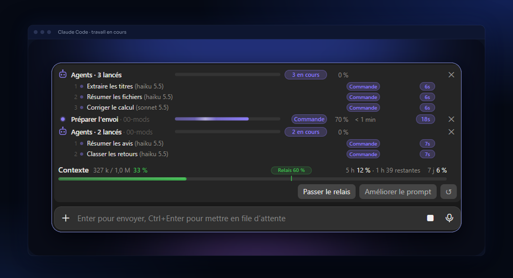
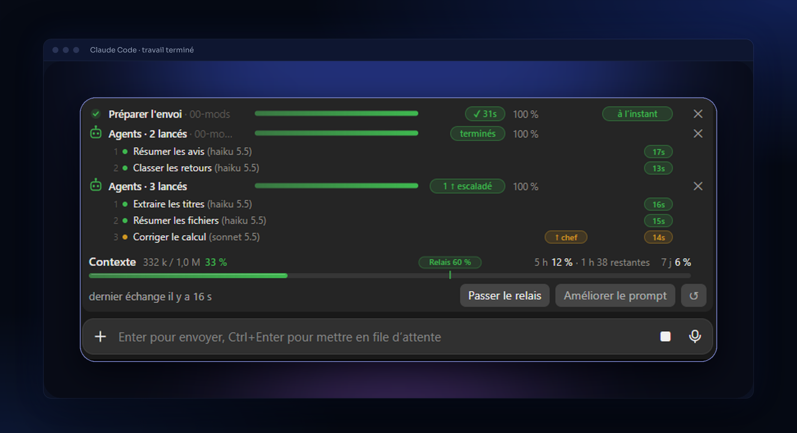

<p align="center">
  
</p>

<p align="center">
  
  
</p>

# Mods Claude Code — Jauge+, Cap, Fil, Plume

> Quatre petits mods personnels pour l'application de bureau Claude Code, faits pour rester sûrs, discrets et économes.
> *Four small personal mods for the Claude Code desktop app: context gauge and session handoff, clickable next steps, task progress bars, and a prompt-polishing button.*

Un mod change l'interface ou le comportement de Claude Code. Chacun de ces quatre mods est un plugin indépendant : tu installes seulement ceux que tu veux.

## ✦ Inspiration

Ces mods sont inspirés du travail de Tony Lotis.

## ✦ Les mods

| Mod | Ce qu'il fait |
|---|---|
| **Jauge+** `0.8.0` | Jauge de contexte au-dessus de la zone de saisie, budget d'usage de la semaine, et **relais** : quand le contexte se remplit, Claude écrit une passation dans `STATE.md` et `DECISIONS.md`, la fait relire à froid, puis vide le chat et reprend tout seul. Rien n'est effacé si la relecture échoue. |
| **Cap** `0.8.0` | Quand une réponse termine le travail sans suite prévue, propose 3 suites cliquables. Rien n'est envoyé sans ton clic. Reste silencieux si une étape est annoncée, si un sous-agent tourne, si une liste de tâches est ouverte ou si Claude pose une question. |
| **Fil** `0.11.2` | Une barre de progression par conversation (liste de tâches, réponse en cours, sous-agents), partagées entre toutes tes conversations. Elle avance en continu, avec le temps dans une bulle colorée et un temps restant estimé dès le départ. Quand Claude s'arrête pour attendre ta réponse, la barre passe en pause (ambre, « à toi », chrono figé), et toute question de Claude sonne, même une fois la liste finie. Un bip à la fin, un double signal en pause (sons CC0 de Freesound, joués aussi sous Windows). `/fil vider` efface les barres terminées, `/fil son` teste le son. |
| **Plume** `0.5.0` | Un bouton qui réécrit ta dictée (fautes, ordre des idées, structure) avec Sonnet, sans rien inventer. Code, liens et chemins sont protégés ; si la réponse est coupée, ton texte reste intact. |

## ✦ Aperçu

Les mods en action dans l'application de bureau Claude Code : une barre de progression par conversation (Fil), la jauge de contexte avec son seuil de relais (Jauge+), et les boutons « Passer le relais » et « Améliorer le prompt » (Jauge+ et Plume).

<p align="center">
  
</p>

Une fois le travail terminé, les barres passent au vert. Un sous-agent qui rend la main à son supérieur est marqué « escaladé » en ambre.

<p align="center">
  
</p>

## ✦ Prérequis

- **L'application de bureau Claude Code**, installée et connectée à ton compte. Ces mods modifient son interface : ils ne fonctionnent pas dans un terminal seul.
- **Windows** : c'est là que les mods sont développés et utilisés. Les sons de Fil passent par PowerShell et les sons de `C:\Windows\Media` ; sur Mac ou Linux, leur fonctionnement est **inconnu** (non testé).
- **Un dossier de projet avec un `STATE.md`** à sa racine, seulement si tu veux utiliser le relais de Jauge+ (voir plus bas). Les trois autres mods n'en ont pas besoin.

Rien d'autre à installer : pas de Node, pas de clé, pas de compte en plus.

## ✦ Installation pas à pas

1. Ouvre l'application de bureau Claude Code, dans n'importe quel dossier.
2. Ajoute le dépôt comme source de mods :

```
/plugin marketplace add horizonchapter/mods-claude-code
```

3. Installe les mods que tu veux. Ils sont indépendants : tu peux n'en prendre qu'un.

```
/plugin install jauge-plus@mods-perso
/plugin install cap@mods-perso
/plugin install fil@mods-perso
/plugin install plume@mods-perso
```

4. Ouvre une **nouvelle conversation**. Les mods ne s'affichent pas dans une conversation déjà ouverte.
5. Vérifie : la jauge de contexte apparaît au-dessus de la zone de saisie (Jauge+), avec les boutons « Passer le relais » et « Améliorer le prompt ».

Pour désactiver un mod : `claude plugin disable <mod>@mods-perso`.

**Sur un autre PC :** refais exactement ces cinq étapes. Les mods ne contiennent ni réglage ni donnée personnelle ; tes préférences (`/jauge seuil`, etc.) sont à refaire sur chaque machine.

## ✦ Utiliser les mods

| Mod | Comment l'utiliser |
|---|---|
| **Jauge+** | `/jauge relais` lance le relais maintenant (ou clique sur « Passer le relais »). `/jauge seuil 55` change le seuil (60 % par défaut). `/jauge auto off` remplace le relais automatique par un simple rappel, `/jauge auto on` le réactive. `/jauge masquer` et `/jauge afficher` cachent ou montrent la jauge sans arrêter la mesure. `/jauge aide` rappelle tout. |
| **Cap** | Rien à faire : les trois suites cliquables apparaissent quand une réponse se termine sans suite prévue. |
| **Fil** | Rien à faire : une barre par conversation. `/fil vider` efface les barres terminées, `/fil son` teste le son. |
| **Plume** | Écris ou dicte ton message, puis clique sur « Améliorer le prompt ». Le texte est réécrit dans le champ de saisie, tu relis avant d'envoyer. |

## ✦ Préparer un projet pour le relais de Jauge+

Le relais vide la conversation quand le contexte se remplit, puis reprend tout seul avec un Claude neuf. Pour ça, Claude écrit tout ce qu'il faut savoir dans deux fichiers à la racine de ton dossier de travail :

- **`STATE.md`** : l'état exact du projet. Tu n'as pas à l'écrire : Claude le réécrit au moment du relais. Il doit simplement exister (même vide) pour que le relais se lance.
- **`DECISIONS.md`** : une ligne par décision, `AAAA-MM-JJ — décision — pourquoi`. Claude y ajoute les nouvelles décisions, sans jamais effacer les anciennes. Il est créé s'il n'existe pas.

À la racine du projet, crée donc un fichier vide :

```
echo. > STATE.md
```

Au relais, Claude remplit `STATE.md` avec les sections suivantes, puis un autre Claude le relit à froid : « Reprise exacte » (tâche en cours, plan, dernière action, fichiers touchés, prochaine action, ne pas refaire), « Objectif », « Où on en est », « Fait », « Demandes de l'utilisateur », « Décidé », « Pièges déjà rencontrés », « Fichiers, liens et chiffres clés », « Attend une validation » et « Questions ouvertes ». Si une section manque ou reste vide, Claude complète avant de vider la conversation (deux compléments au plus).

Un exemple fictif complet est dans [`exemples/STATE.exemple.md`](exemples/STATE.exemple.md), avec [`exemples/DECISIONS.exemple.md`](exemples/DECISIONS.exemple.md). Les vrais `STATE.md` et `DECISIONS.md` sont ignorés par Git (voir `.gitignore`) : ils restent chez toi. Aucune clé ni mot de passe ne doit y figurer.

## ✦ Si ça ne marche pas

- **Rien ne s'affiche** : ouvre une nouvelle conversation après l'installation ; vérifie que tu es dans l'application de bureau.
- **Le relais ne se lance pas** : il manque `STATE.md` à la racine du dossier de travail. Ouvre la session à la racine du projet, là où se trouve ce fichier, et non dans un dossier parent ou un sous-dossier.
- **Pas de son avec Fil** : `/fil son` pour tester ; hors Windows, le résultat est inconnu (voir Prérequis).
- **Un mod gêne** : désactive-le avec `claude plugin disable <mod>@mods-perso`, les autres continuent de fonctionner.

## ✦ Ce que ces mods font de tes données

- Aucun appel réseau, aucune clé, aucun fichier `.env` lu.
- **Jauge+** lit et écrit `STATE.md` et `DECISIONS.md` à la racine du dossier de travail, et garde ses sauvegardes dans `.passations/`. Il demande un modèle de relire la passation.
- **Cap** demande à Haiku si la dernière réponse se termine sans suite. Il lit aussi la ligne « Prochaine action » de `STATE.md` s'il existe, et ajoute à ton message une consigne : enchaîner le plan déjà validé, et s'arrêter avant toute action irréversible.
- **Fil** écrit un petit fichier par conversation dans `~/.claude/fil-sessions` pour partager les barres.
- **Plume** envoie le texte du champ de saisie à Sonnet, uniquement quand tu appuies sur le bouton.

## ✦ Limites connues

- Pensés pour l'application de bureau Claude Code ; non testés ailleurs.
- Jauge+ exige un `STATE.md` à la racine du dossier de travail pour lancer un relais.
- Plume : un texte tapé pendant la réécriture peut être écrasé.
- Projet personnel, sans garantie : à utiliser à tes risques.

## ✦ Tests

Chaque mod embarque ses tests dans `hooks/` (`*.test.ts` ou `*.test.tsx`) : `claude plugin test <dossier-du-mod>`.

## ✦ Licence

MIT. Voir [LICENSE](LICENSE).
